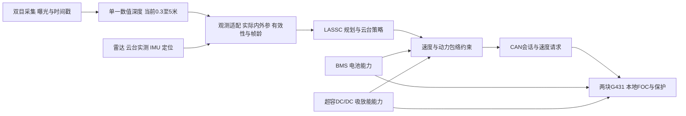

# 先进通用履带底盘工程

本项目的当前目标是优先提高高速行驶、复杂地形通过和户外感知性能。本页维护整车技术边界、算法与电路接口、关键差距和验收条件；模块设计仍在原目录维护，协作分工与行动状态统一放在[项目协作](项目协作.md)。

## GitHub 与工程获取

主仓库为 [w3743/AGTC](https://github.com/w3743/AGTC)，可见性为私密。AGTC 表示 Advanced General-purpose Tracked Chassis。原元器件共享库的提交历史保留在本仓库中，当前器件管理统一位于[电力/元件封装库](电力/元件封装库/README.md)。

安装 Git 和 Git LFS，并确保账号具有仓库访问权限后：

```powershell
git lfs install
git clone --recurse-submodules https://github.com/w3743/AGTC.git
cd AGTC
git lfs pull
git submodule status --recursive
```

机械 CAD、模型检查点、归档及大型二进制由 Git LFS 保存；训练协议、源码快照、结果与设计证据保留在相应模块。Isaac Lab、llm-viz 和 LightStereo 上游按 submodule 固定提交。本机缓存、虚拟环境、临时文件、凭据和编辑锁不入库；运行依赖按各模块现有说明安装。仓库完整不代表实物验收或训练效果通过。

日常修改使用任务分支和有明确范围的提交，通过 PR 合入 `main`；先检查暂存差异和相关验证，再推送。共享工作区由总协调串行操作 Git，不强推、不覆盖远端历史。具体约定见根目录 [AGENTS.md](AGENTS.md)。

检查日期：2026-10-21，Asia/Shanghai。范围覆盖当前算法源码与训练证据、电力现行设计与检查记录、机械文件清单，以及相关对话中的用户最新要求。机械 CAD 未打开提取质量属性；本轮不以旧 DRC、模型测试或训练更新代替实物验收。电路对话正并行修订设计，修改后的资格以该模块对应版本的证据为准。

## 项目入口与当前约束

| 内容 | 入口 | 用途与边界 |
|---|---|---|
| 算法训练 | [Isaac Lab 使用说明](算法/仿真训练环境/使用说明.md) · [协作与运行要求](算法/仿真训练环境/AGENTS.md) | Isaac Lab、Newton、RecurrentPPO；历史实验与各自冻结协议分别管理 |
| 视觉 | [视觉目录](算法/视觉算法/README.md) · [当前单深度部署](算法/视觉算法/软件/数值深度接口候选/README.md) | 当前生产源和证据由部署入口维护；旧板端备份仅供对应版本追溯 |
| 定位 | [定位算法目录](算法/定位算法/) | 当前含基站测距示例和 GNSS 仿真，不能直接当作整车定位服务 |
| 电力 | [电力总入口](电力/README.md) · [基本设计](电力/基本设计.md) | BMS、两块同版 FOC、超容双向 DC/DC、水泵及共用器件库 |
| 机械 | [整车装配](机械/车.SLDASM) · [云台装配](机械/炮台.SLDASM) | 原生资产入口；需导出当前质量、质心、惯量和关键尺寸，才能与仿真对账 |

本页采用的用户要求：

- 优先追求高速、复杂地形和户外感知的性能上限；当前最高速度设计输入仍为 15 km/h。
- 保留现有相机和 RK3588；远距目标从原 5 m 扩展到数十米。用户随后要求仅保留一个深度输出、去掉当前远距图和点云；当前生产 profile 仍为 0.3–5 m。数十米属于长期目标，尚未形成已验证的距离精度承诺。
- 板卡尚未打样，允许优化选型；超容固定使用现有 LICAP SC0350-270-RSS，350 F、2.7 V，型号不变，允许调整串并联数量。超容稳压模块的 500 元上限已取消；BMS 等其他模块各自的成本要求保留。
- 用户后续已明确授权“接口验证通过后恢复训练”。接口软件门槛通过后，训练负责人使用独立 child 续训并串行安排评估与课程；父 trial 的冻结源、协议、检查点和历史成绩继续保留。GPU 由训练负责人统一调度，原生 automation 仍为 PAUSED。
- PCB 布局布线由人类完成；代理负责方案、原理图、接口、工具和证据核验。

上述更新分别来自“细致检查并规划算法与电路”“打开 RK3588 预览界面”“检查并优化电路设计”中用户的直接答复；各模块现行要求由对应负责人原位同步。

## 当前检查结论

项目已有可复用的仿真、训练、遥测协议和原理图基础。板端数值输出、LASSC 生产消费桥和真实模型 CPU 回放已通过软件验收；控制组训练与配对开发评估也已完成，但任务成功率没有提升。当前主要差距为实际学习效果、真实动力包络、实车时钟/外参以及植物和复杂地形覆盖。

| 检查对象 | 结论 | 证据与限制 |
|---|---|---|
| 算法结构与协议资产 | PASS，限静态确认 | 五路输入融合、LSTM、左右履带速度与云台速率动作、CAN 黄金向量均有实现 |
| 已有代码回归 | 历史测试 PASS | 最近整理记录为 CPU 377 passed / 20 skipped、Newton 20 passed；本轮没有重跑，不代表模型能力通过 |
| 当前模型的定点能力与复杂任务能力 | 未满足验收条件 | 恢复控制组配对成功 0/8→0/8、进入0.4 m范围0/8→0/8；plants=0、rocks=0，不证明避苗 |
| 实车策略到双电机闭环 | 未满足验收条件 | 主机 codec 已有，目标 G431 FOC/HAL、真实 CAN 收发、电流环与速度环仍是待办 |
| 数值深度接入 | PASS，限软件与回放 | 生产接口与 LASSC 消费桥已实现；契约69项、consumer4项、真实检查点CPU回放17项、原样在线负例7项分别通过。真实时钟/外参缺失时正确拒绝，deployment_ready=false |
| 电源保护与功率额定 | 未满足整车验收条件 | 存在器件计算、模型与原理图证据；不能证明双驱连续能力、共享回馈、失电制动和热资格 |
| 机械与仿真一致性 | 待核 | CAD 资产存在；质量、质心、惯量及真实接地与滑移未和代理模型对齐 |

恢复控制组 `random_global_rough_fast_stop_lstm512_resume_20261021_attempt2` 已从父 trial 的 57,344 步检查点与 Adam 状态续训至累计 196,608 步，自然退出码为 0；独立最终模型 CPU 审计 24/24 通过。评估使用 summary 指定的 `stage_01_global_random.zip`，不能以同为 196,608 步的周期检查点替代。实际退出和模型身份见[完成摘要](算法/仿真训练环境/results/isaac_field_improvement/random_global_rough_fast_stop_lstm512_resume_20261021_attempt2/resume_summary.json)、[退出记录](算法/仿真训练环境/results/isaac_field_improvement/random_global_rough_fast_stop_lstm512_resume_20261021_attempt2/process_exit.json)和[最终CPU审计](算法/仿真训练环境/results/isaac_field_improvement/random_global_rough_fast_stop_lstm512_resume_20261021_attempt2/final_checkpoint_cpu.json)。

57,344 步基线与最终模型在 rough_a/rough_b、每组4个相同初态上的配对评估共16回合，已完成并退出0：**无损成功0/8→0/8、进入0.4 m范围0/8→0/8、最长停稳保持均为0秒**；两者均无损伤/碰撞，越界3→0。两个 split 均为 `no_improvement`；越界减少或离目标更近不等于任务成功率提高。原始结果见[评估运行清单](算法/仿真训练环境/results/isaac_field_improvement/random_global_rough_fast_stop_lstm512_resume_20261021_attempt2_evaluation/run_manifest.json)、[配对比较](算法/仿真训练环境/results/isaac_field_improvement/random_global_rough_fast_stop_lstm512_resume_20261021_attempt2_evaluation/comparison.json)和[最终评估审计](算法/仿真训练环境/results/isaac_field_improvement/random_global_rough_fast_stop_lstm512_resume_20261021_attempt2_evaluation/evaluation_cpu_audit.json)。这是开发集比较，不是独立盲测或实车验收。

控制与评估退出后，短距课程 `fast_stop512_mastery_20261021_attempt2` 于11:29北京时间串行启动，首8192步检查点已通过独立CPU审计21/21，确认权重和Adam状态实际更新；这不等于近场能力或课程晋级通过。后续进度直接查[课程实时状态](算法/仿真训练环境/results/isaac_field_improvement/fast_stop512_mastery_20261021_attempt2/run_status.json)与相应验收记录；Git提交只保存提交时已落盘的记录，运行中的后续产物需增量提交。父 trial 的历史暂停与旧PID消失记录只作追溯，不再描述当前运行状态；旧393,216步实验也不混入本轮结果。

## 整车架构与接口分工



保留 LASSC 对行驶和云台的联合决策。感知适配、动力限制和本地保护各自有确定的输入、时效与失效行为；策略不能绕过实际可用能力。CAN 传协调、状态和能力，快速电流环、母线瞬态处理与硬件关断在本地完成。

| 跨域接口 | 现有基础 | 必须形成的合同 |
|---|---|---|
| 双目→感知 | 已部署单一 `/depth.bin`，uint16 小端毫米轴向 Z，0 无效 | 保持载荷与元数据同帧绑定；真实时钟映射和外参不能从软件fixture推得，未知项继续明确标记并拒绝实车就绪 |
| 感知→旧策略 | float32 `(C,H,W)=(1,160,88)`，有效值 `Z_m/5`，无效 0 | 源 uint16 的 0 先标无效，毫米转米后按原始量程生成 valid，再做几何映射；显式掩码用于适配层/任务帧，旧策略 CNN 仍接收单通道。未知、遮挡和近距盲区不等于空旷 |
| 感知→新策略 | 尚未冻结 | 近场深度与远场 ROI/目标信息的量程、尺度、时间、无效编码和不确定度；新增 schema 和独立实验，不能只把 `/5` 改成 `/30` |
| 定位/云台/IMU→策略 | 云台 IMU 和反馈 schema 已有 | 车体、两轴云台、光心、IMU、雷达、地图的坐标链与正方向；测量时刻姿态；定位更新、协方差和失效行为 |
| 策略→驱动 | 归一化左右履带速度；FOC 接收电机轴机械 RPM | 用实测方向、主动轮半径与减速比换算；boot/session/seq/TTL；限值、请求值和实际执行值分开回报；动作不能冒充反馈 |
| 电源→驱动/规划 | BMS CCL/DCL、超容能力模型 | 整车总额度与每侧额度、单位/符号、持续时间、有效期、温度/电压/SOC 条件；双驱不得各自花掉同一份总额度 |
| 失效与停机 | 局部保护链和停机约束已有 | 区分停止牵引、可用制动、失电默认态、实体隔离、残能与重新许可；回馈额度为零时仍要有定义明确的减速/停车方案 |

FOC 现行协议为经典 CAN 11-bit、DLC 8，定义了自身的应用 CRC、会话与反馈配对。BMS 的局部协议采用另一套约定；不能未经版本变更把两者硬改成同一帧格式。先登记全节点 ID、速率、周期、最坏总线负载、终端位置、线束针脚与故障优先级，再从单一信号定义生成 DBC/解析代码。本轮在当前模块与算法源码范围未找到完整整车 DBC/ARXML，不排除其他位置另有材料。[FOC 协议](电力/FOC驱动模块/软件/速度反馈协议.md)、[BMS 接口](电力/BMS模块/原理图准备/控制与接口设计.md)是合并输入。

FOC `device_tick_ms_low16` 的 65.536 s 回绕计数只适合同一设备相邻间隔；主机接收时刻能判断收包新鲜度，不能替代采集时间同步。现行项目按 ATK-IMU901 随云台运动建模，实物安装轴向、偏置与外参仍待核验。随动安装下，固定旋转变换不足以去掉云台角速度、杠杆臂加速度和时间错位；应使用测量时刻的实测云台反馈及运动学补偿，并单独验证车体状态估计。现有姿态 schema 不等于动态补偿已实证。

## 高速感知和制动预算

15 km/h = 4.1667 m/s。以下使用 `task.py` 的仿真配置做条件算术，用于发现接口不匹配；不是板端时延或实车制动测试。300 ms 是仿真深度 latency 假设，表内未单独加入物理曝光、滚动读出与同步误差，它们须在实机全链测量中计入。

| 量 | 当前配置或算式 | 条件结果 |
|---|---|---:|
| 一个策略周期的行程 | 20 Hz，`v × 0.05 s` | 0.208 m |
| 深度通道最坏采样相位与延迟 | 刚错过一帧，`0.4 + 0.3 + 0.05 s` | 0.75 s，前进 3.125 m |
| LiDAR 通道相同口径 | `0.1 + 0.03 + 0.05 s` | 0.18 s，前进 0.75 m |
| 假设匀减速距离 | `v²/(2a)`，暂代入 `a=1.5 m/s²` | 5.787 m |
| 深度通道合计 | `3.125 + 5.787 m`，尚未加驱动延迟与余量 | 8.912 m |
| LiDAR 通道合计 | `0.75 + 5.787 m`，同样未加余量 | 6.537 m |
| 100 ms 延迟造成的行程 | `v × 0.1 s` | 0.417 m |

**1.5 m/s² 是当前速度命令斜坡假设，不是实测减速度。** 上表不能用来直接设定实车制动参数。深度最大 5 m、LiDAR 抽象最大 8 m 也不是所有目标均可可靠检测的距离；云台朝向、遮挡、扫描平面、坡度和倒车会进一步改变有效视距。各通道按自己的采样与延迟预算，不能把深度的 0.75 s 套给雷达。

整车判定采用 `可靠可见距离 ≥ v×全链反应时间 + 实测制动距离 + 目标运动/测量/车体包络余量`。反应时间包含曝光/帧相位、读出、匹配、传输、策略调度、CAN、控制器到电流响应；分别记录 p50/p95/p99、最大观测年龄及超期次数。20 Hz 策略的单次计算与调度需满足 50 ms 截止期，但不要求相机曝光到动作的总延迟也等于 50 ms。曝光到动作 p99≤100 ms 可作为首轮优化候选，是否充分仍由制动和视距预算决定。该思路可复用 [Nav2 Collision Monitor 的速度相关区域与停车距离方法](https://docs.nav2.org/rolling/tutorials/general_tutorials/using_collision_monitor/using_collision_monitor/)，无需为此替换现有规划器。

### 单一深度输出与远距研究边界

现有双摄为 IMX415、基线约96.3 mm；当前常态由 ISP 按需直出每眼640×360、约30 FPS，主深度为131×240、0.3–5 m，producer短测约27.30 FPS。传感器驱动仍为4K原生模式，持续4K编码/传输已关闭；标定/拍摄原图时才按需使用高分辨率。71项本地回归通过与短测吞吐都不等于距离精度、长期热稳定性或 sensor-to-action 时延验收。活动源、部署SHA和回滚包由[当前部署入口](算法/视觉算法/软件/数值深度接口候选/README.md)维护。

此前读取的普通模式 HDR 合成关闭、约30 ms曝光估算属于当时配置，不能套作本次直出部署的精确曝光测量。硬件曝光同步、联动AE与HDR运行控制仍未验证；IMX415的滚动快门约束继续保留。芯片具备某模式不等于当前模组、驱动和ISP已稳定启用。[Sony器件资料](https://www.sony-semicon.com/files/62/pdf/p-12_IMX415-AAQR_AAMR_Flyer.pdf)提供器件能力边界。

按用户最新要求，生产服务仅保留一份深度输出，远距图、点云、点击测距和独立NPU预览已移除，不恢复平行生产分支。后续更远量程先做离线研究，再在统一输出与明确profile下验证。此前“保留原像素密度做局部匹配”只作为可复现的历史研究路径：若研究ROI，须包含对应极线搜索区域和标定变换，保留帧龄与不确定度；最终压回88列仍会丢失细节。当前先验证室内0.3–5 m和范围外误报，户外飘动植物、运动和光变留待现场条件。

当前仿真 `fx≈98.3248 px`，24 mm 正视茎宽按 `p=fx×0.024/Z` 计算，1/2/5 m 分别约 2.36/1.18/0.47 px。维持相同视场，5 m 达到 2/3 px 约需 W373×H678 / W559×H1017；这只是采样预算，尚不保证识别。该尺寸要求保留原始像素进行匹配或 ROI 处理，放大现有 88×160 深度结果不能恢复细节。新输入不应先拍定全幅高分辨率，应比较多尺度与 ROI 在 RK3588 上的精度、内存和延迟。

原始标定 `P1` 焦距约 2359.795 px、`-P2[1,3]/1000≈227.217 px·m`。按 `d=fB/Z` 和 `σZ≈Z²σd/(fB)`，假设匹配误差为 0.25 px：

| 距离 | 原像素密度下视差 | 距离误差传播估算 |
|---|---:|---:|
| 10 m | 22.72 px | 0.11 m |
| 20 m | 11.36 px | 0.44 m |
| 30 m | 7.57 px | 0.99 m |

这些是忽略标定、曝光不同步、滚动读出和重复纹理的理论传播值。30 m 的 24 mm 茎即使保留原像素密度也仅约 1.89 px，远距大目标测距与远距细茎避苗应分开验收。5 m、10 m、20 m、30 m 设为测试距离，不把“数十米”统一解释成全部目标均满足同一精度。

数据层沿用 [REP 118](https://reps.openrobotics.org/rep-0118/) 的轴向 Z 语义和米/毫米表示。当前旧策略适配必须在裁剪前生成有效性；`task.py` 的省略掩码分支会先 clip，再推导 valid，板端 0 可能被当作有效 0.3 m。按实际 K 建立射线映射，最近邻为复现基线；深度与掩码共用索引，映射外保留无效，保近障聚合作独立对照。`valid=true` 只说明通过筛选，不能直接称为测距正确或已校准置信度。

## 动力电路与机械能力预算

| 项目 | 现行输入或候选 | 整车规划需要补齐的条件 |
|---|---|---|
| 电池 | 9S4P、EVE INR18650-30P，22.5–37.8 V | 60 A 连续、100 A/1 s、净充电上限 16 A 仍待板级、成组和温度资格；满电/低温可用吸能能力可降为零 |
| 双驱 | 每板 1.8 kW 输入、1 s 选型筛查；两板合计 3.6 kW 请求 | 需确认连续/脉冲/重复率、母线与相电流口径、R/L/Kt、转速、热降额及 37.8 V 电机适用性 |
| 超容 | 固定使用本页约束所列 LICAP 单体；现行设计 8S1P、350 F/节 | 只调整相同型号单体的串并联数量；能量窗、寿命降额、ESR、转换效率、逐节保护和电感/开关峰值共同限制可用能力 |
| 整车制动 | 电池＋超容吸收＋泄放的系统分配待定 | 满电、SC 满电、低温、额度失效、MCU失效及持续下坡分别定义能量去向；关门极不等于没有体二极管回馈 |
| 辅助供电与冷却 | 有 5 V/12 V 模块候选；BMS 仅上传温度 | RK3588、双摄、雷达、云台、各核心板的启动/峰值与故障隔离预算；独立冷却板与 MPPT 的接口仍需跟进 |

按 `P=VI` 作上限算术：电池 60 A 对应 1.35–2.268 kW，100 A 对应 2.25–3.78 kW；均未扣线损和辅助负载，且这些电流尚未资格确认。双驱同时请求 3.6 kW 时，低压点相对 100 A 候选仍缺 1.35 kW；相对 60 A 候选缺 2.25 kW。因此“超容补 800–1000 W、1 s”只是一个场景，不能覆盖全部低压双驱峰值。应从允许的任务工况反推电池和超容的总/分支额度，不能用单个瓦数解锁所有工况。

电池的 16 A 是设计上界，不能直接给算法使用。审计读取的 BMS 现行说明仍记录电芯温度探头未接入正式原理图，只有板温/MOS 温度；三路电芯 NTC 正由电路对话补齐。温度范围、支路电流与其余资格不完整时，当前参考算法的 CCL=0；即使探头落图，也还需同版传感器诊断、测温覆盖和固件验证。[16 A 验证](电力/BMS模块/检查/16A净充电上限验证.md)限定了该模型的输入条件。

现有超容逐节资格模型报告：100 mV 条件误差预算未通过，已知条件应力约 339.174 mV，不是完整全温最坏界；80 A 与 50 ms 端到端切断未实测。寿命容量及中点窗口下，理想 BUS 能量约 618.45 J，不能证明 800–1000 W 持续 1 s。增容可改善能量与部分压降，不能补齐测量精度和关断证明；具体 8S2P 等候选由电路负责人同时计算并联均流、ESR、保险、预充、布置与保护。本页不把尚未落图的方案列为现行硬件。[逐节资格模型](电力/稳压模块/检查/未通过项修复/BUSFIX_逐节保护资格复查.json)保留计算条件。

系统已有约束示例：60 mF 母线电容从 37.8 V 升至 45 V 仅容纳约 17.885 J，1 kW 剩余注入约 17.9 ms 就消耗这一电压窗；45 V 只是模型筛查点。300 ms CAN 能力失效规则不能承担瞬态过压处理，隔着 DC/DC 的超容也不能计为瞬时直连电容。当前稳压方案没有独立硬件 BUS_OV 泄放，MCU/ADC/PWM 故障处置仍开放；FOC 的局部泄放也必须核各自供电、阈值和失效路径，不能互相默认对方兜底。

机械输入为 30 kg、车体 800×300 mm、外宽 470 mm、单侧履带宽 60 mm、中心距 410 mm、接地长 595 mm、主动轮直径 60 mm、减速 4:1。当前代理使用每侧七个 R45 mm 轮和同侧等式约束；14 执行器每轮 2 Nm、Kt=.035、效率 1 不是两台真实电机的资格值。保持已有机械联动，优先校准接地包络、滑移、负载转向、质心/惯量和驱动效率；只有实测残差表明需要时才扩大连续履带或土壤模型的复杂度。

15 km/h 对应电机轴约 5305 rpm。理想无载 `n=270×V`、60 mm 主动轮、4:1 下，22.5/32.4/37.8 V 对应约 17.18/24.73/28.86 km/h；这些不是负载速度，只说明实际限速不能靠策略归一化。30 kg 在 15 km/h 下平动动能约 260.42 J，不含转动动能与下坡势能；一次平地停车能量合适也不证明能持续下坡制动。[电驱边界审计](算法/仿真训练环境/results/hardware_limits/foc_20261020/README.md)给出当前候选与实物证据的区分。

## 优先差距与交付验收

P0 表示会阻塞接口闭环或高速实车放行；P1 表示决定性能上限的下一组工作。责任聊天和具体执行状态只在 `项目协作.md` 维护，避免本页形成第二份任务台账。

| 编号 | 等级 | 差距与最小交付 | 验收条件 |
|---|---|---|---|
| T01 | P0 | 可构建的 G431 FOC 目标工程＋主机动作适配，复用现有 codec 与黄金向量 | 目标构建通过；双侧方向/RPM/Iq/执行序号实测；会话重启、丢包、重复/乱序、TTL、复位与限流行为有波形/日志 |
| T02 | P0 | 电池、超容与双 FOC 的总/分支功率和回馈合同 | 单位与四象限符号一致；两侧额度总和受整车上限约束；未知/过期额度保守退化；满电、低温、拒绝吸能和持续下坡各有本地响应 |
| T03 | P0 | 保持已验收的全幅数值深度与消费桥，补齐真实采集时钟/外参 | 软件与回放门槛已过；同seq/无效值/坏帧不推进LSTM等回归继续保留；真实时钟/外参核实后才能解除实车ready限制 |
| T04 | P0 | 失联/失电停车、实体关断与残能处置矩阵 | CAN 静默、进程卡住、传感失效、辅助失电、门驱故障时，记录 Gate/PWM、电流、母线残压、能量去向与重新许可条件；维护线/停放开关不冒充急停 |
| T05 | P0 | 感知→规划→电流响应的时延及制动包络 | 按地面/坡度/载荷/SOC/温度给原始测量；满足可靠视距不等式；不足时本地/上层限速，不能仅靠策略学会慢行 |
| T06 | P1 | 单一输出下的近远距离精度与时延评估 | 当前先测0.3–5 m与范围外误报；更远profile先离线研究，不恢复独立远距图；分别报告大目标、细茎、重复纹理、运动与光变的误差/缺测/延迟 |
| T07 | P1 | 机械参数与传感器外参基线 | 当前 CAD/实测质量、质心、惯量、履带包络与云台轴位置可追溯；IMU/云台运动补偿和双目/雷达时间对齐有动态验证 |
| T08 | P1 | 新观测、真实动力约束和地形族的独立训练方案 | 新 schema/新 trial；保持旧 45 源与协议；单变量对照；开发与未观察验证集分开；报告速度分布、停车距离、时间、无损成功与失败原因 |
| T09 | P1 | 真实植物感知、跨帧目标与地图接口 | 当前仿真分割/leaf_dry 真值生成的检测不能充作实车识别；真实数据留出集的召回/误报/距离、跨帧重复标记和地图坐标误差分别验证 |
| T10 | P1 | 主控辅助供电、冷却、MPPT 与泵的整车负载预算 | 明确启动浪涌、峰值/持续功耗、60°C环境热条件、温度报文与失联行为；泵卡转/启动不使主控复位或绕过电源能力分配 |
| T11 | P2 | 当前源与文档入口一致，单一接口登记与释放基线 | 本地/板端代码、模型、runtime、标定、图纸/BOM版次可对应；修正失效路径；历史检查只支持其对应源版本 |

## 推进顺序与性能评测

当前 T03 的生产消费软件与回放门槛已过，机械参数记录也已建立；接下来优先补真实时钟/外参、T02电源能力与T01目标固件链，不重复实现已通过的软件接口。实物能力未取得前，仿真参数分别标注已确认、候选和未知，不将候选变成运行许可。

第二阶段取得 T04/T05 的限流台架与低速实测，校准两侧速度/电流/转矩、执行延迟和回馈分配，同时在固定相机/RK3588 上完成 T06。20 Hz 运行时显式维护 LSTM 状态、回合/会话重置、输入有效性和超期处理；先以 CPU PyTorch/TorchScript FP32 为参考校验数值一致性，再评估量化。本地 Netron 导出脚本是含 critic 的 CPU 查看/对照入口，尚不是 RKNN 转换与板端运行时。RKNN 工具链可复用，NPU/CPU 的算子分配、LSTM 回退路径、精度损失、内存、温度降频及完整循环 p99 均未在本项目板端验证，不承诺整张递归网络都能无损放进 NPU。[RKNN 官方工具](https://github.com/airockchip/rknn-toolkit2)提供转换与评估能力，升级需与现有驱动/runtime相容后单独验证。

学习效果工作复用现有mastery、配对评测、检查点和SHA机制，控制组失败后已由训练负责人串行启动短距课程，先检验接近—刹停，再扩大转角与距离。当前保留0.4 m位置范围、水平速度<0.05 m/s、完整角速度<0.1 rad/s连续0.5 s；不因失败直接放宽成功判据。感知、动力、地形变化分别建对照；新随机课程与57344步续训控制组不自动构成严格因果对照。Isaac `DCMotor`可复用转矩—转速包络，电池、热和吸能限制仍须另外接入。快停goto与农田探索分别评分，训练步数与软件门槛通过不能代替任务能力提升。

第四阶段在同一发布基线上逐级提高速度，扩大坡面、坑洼、石块、附着、遮挡和光照变化范围。每次升级必须同时满足感知视距、制动/姿态/功率/温度边界；某维退化时保留自动降级。高速指标包括实际速度分布和保持时长，不能只报告允许请求的最大值。机械台阶必须记录整车完全越过、接触/滑移和姿态，不能以导向轮触碰视为通过。

| 评测组 | 固定或记录的条件 | 必报结果 |
|---|---|---|
| 视觉与采集 | 标定版本、原始左右帧、曝光/增益/模式、配对偏差、运动速度、距离真值、细茎尺寸 | 距离 MAE/p95、大误差率、缺测/覆盖、目标召回/误报、帧龄 p50/p95/p99、最长队列与丢帧 |
| 动力与制动 | 包压/SOC/温度、载荷、地面/坡度、左右速度、电流/电压/功率、可用吸能 | 速度/加减速、实际停车距离、限流和热降额、双侧总额度、BUS峰值、失效响应与残压 |
| 算法与仿真 | 实际资产/SHA、初态/地形种子、动力/观测schema、模型/Adam、终止与统计口径 | 无损成功率、碰撞/损伤/越界/姿态失败、完成时间、速度分布、功率/感知超期；保持同初态成对比较 |
| 整车集成 | 图纸/BOM/固件/模型/标定/runtime/线束基线 | 多源同步日志与故障注入结果；传感无效与通信恢复不能自动恢复未经允许的驱动状态 |

## 证据边界与文件维护

1. 算法配置与假设直接见 [task.py](算法/仿真训练环境/isaac_field/task.py) 第 22–33、59–101、1016–1022 行，[env.py](算法/仿真训练环境/isaac_field/env.py) 第 75–109、206–244、548、629 行，[assets.py](算法/仿真训练环境/isaac_field/assets.py) 第 60–85、132–148 行。引用行号用于定位，源码变更后须重新核对。
2. 父trial与恢复前记录见[原fast-stop整理验收](算法/仿真训练环境/results/project_history/cleanup_and_validation_20261020_batch16.md)及其历史暂停记录；父57344步ZIP SHA256=`db473f5e78038c066226f61cb6a5ee02ea71615823f28e519366cb0809ecbb8a`。恢复child最终模型SHA256=`c5ab17ceb785e1abfed0a1bfc292b1ad31912801ea91b6e77f672463a508585b`，真实退出/CPU审计/配对结果使用本页当前结论所链文件。当前接口验收见[QA gate](算法/仿真训练环境/results/lassc_interface_20261021/qa_gate.json)：软件放行可用于仿真续训，deployment_ready=false；各套件计数分开，不相加冒充单套件。
3. 电驱硬件边界见 [FOC 待办](电力/FOC驱动模块/TODO.md)、[保护与固件约束](电力/FOC驱动模块/保护与固件约束.md)、[BMS 用户要求](电力/BMS模块/项目要求.md)、[BMS 当前状态](电力/BMS模块/检查/当前设计状态.md)、[超容保护边界](电力/稳压模块/计算与保护边界.md)。电路当前修订完成后重新核对 T01/T02/T04，不沿用先前 DRC 数字。
4. 双目几何见 [当前标定报告](算法/视觉算法/软件/stereo/calibration/current/report.md)与[参数](算法/视觉算法/软件/stereo/calibration/current/parameters.npz)。几何拟合通过不等于实际距离、户外运动与地图精度验收。
5. 2026-10-21 01:19板端备份仅支持当时版本的缓存/时间记录结论；活动生产源已由视觉负责人更新，不用旧包成员SHA证明当前部署。当前源身份、fixture、回归和部署SHA统一从[生产部署说明](算法/视觉算法/软件/数值深度接口候选/README.md)进入，数据语义唯一来源为[深度接口契约](算法/视觉算法/深度接口契约.md)。
6. 历史 `LightStereo源码`、旧板端备份和现行生产部署不并列为三个现行入口。机械参数记录由[参数基线](机械/参数基线.json)维护；记录通过不等于CAD质量属性或实车测量通过。

本次状态同步只读取现有交付并更新本页，没有启动训练、评估、GPU或automation，也没有修改模块源和历史成绩。模块实际实现与训练由对应负责人完成；后续变化仍原位更新，不另建状态文档或总体方案目录，组织分工只在根 `项目协作.md` 维护。
